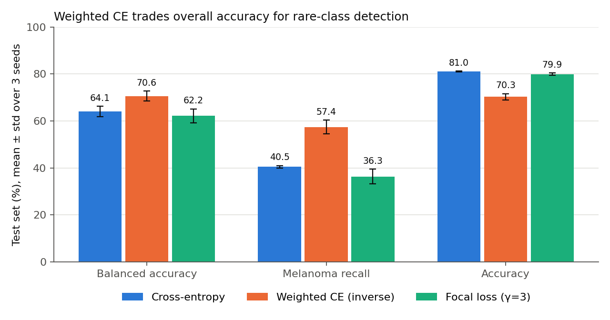
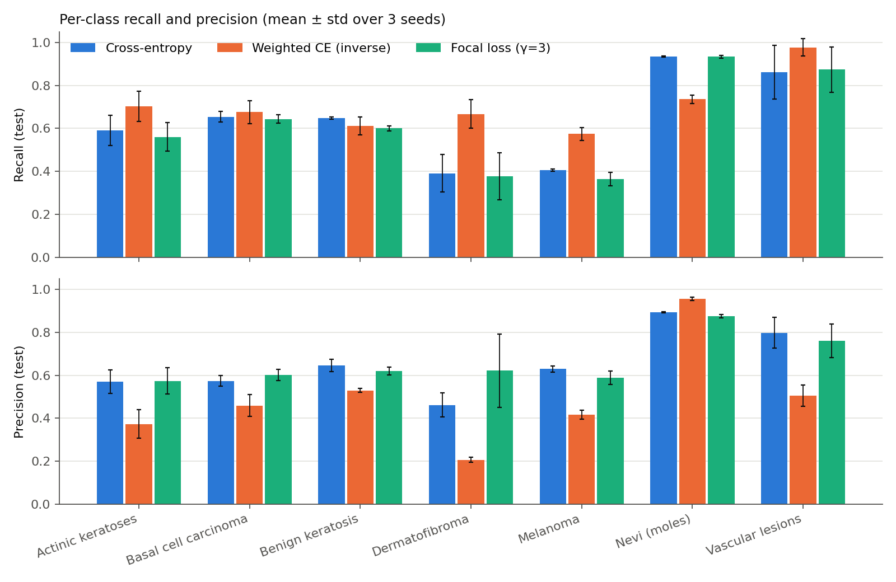
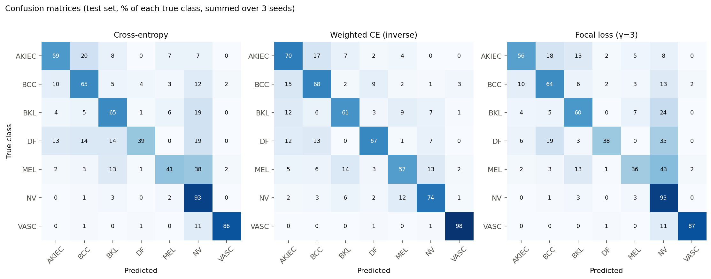
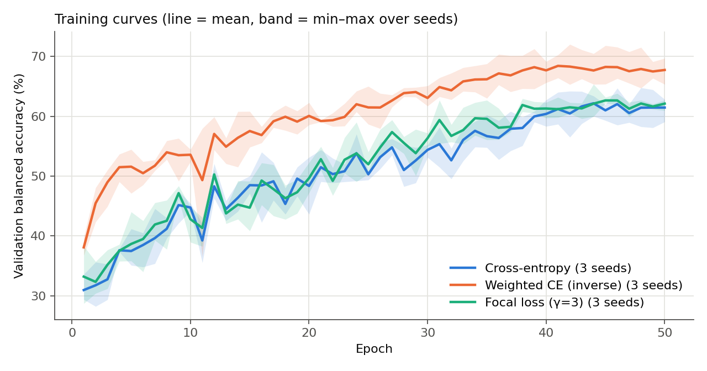
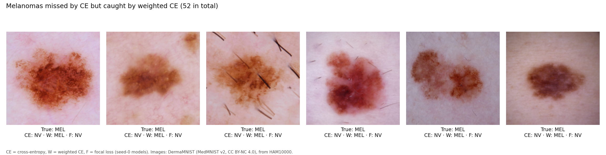
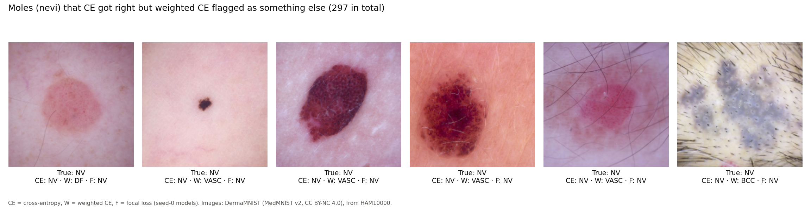
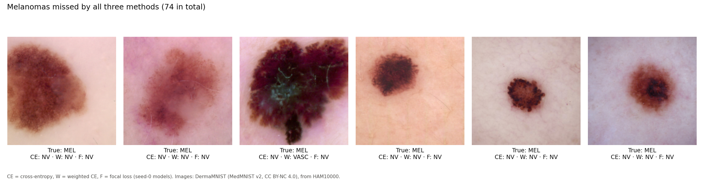

**ELEC-6661 Final Project · Concordia University · Fall 2026**
Team: Person A (Mohammad Qais Arshad), Person B (Mohammad Mohibul Haque), Person C (Ifthakhar Parvez Prothoy)
Code: [github.com/Qais-2000/MedViTV2](https://github.com/Qais-2000/MedViTV2)

---

## 1. Problem

Skin cancer datasets are highly imbalanced: most images are harmless moles (nevi), while dangerous or rare lesions such as melanoma and dermatofibroma are a small fraction. A classifier trained with the standard cross-entropy loss can reach high overall accuracy by mostly predicting the majority class, while missing the cases that matter most clinically.

**Our question:** does imbalance-aware training — **class-weighted cross-entropy** or **focal loss** — improve detection of rare skin lesion classes with the MedViTV2 model, and what does it cost in precision and overall accuracy?

## 2. Baseline and reproduction

*Section by Mohammad Qais Arshad*

### The baseline we build on

We use **MedViTV2** (Manzari et al., *Applied Soft Computing*, 2025), a vision transformer that combines Kolmogorov–Arnold Network (KAN) layers with dilated neighborhood attention. The code is public at [github.com/Omid-Nejati/MedViTV2](https://github.com/Omid-Nejati/MedViTV2) (also mirrored by the IMPACT Lab) under the MIT license. We use the smallest variant, **MedViT-tiny**, because it has a released DermaMNIST checkpoint and fits our compute budget.

### Dataset

**DermaMNIST** (from the MedMNIST collection, based on HAM10000) at 224×224 resolution, 7 classes, with the official splits:

| Class | Train | Val | Test |
|---|---|---|---|
| Actinic keratoses | 228 | 33 | 66 |
| Basal cell carcinoma | 359 | 52 | 103 |
| Benign keratosis | 769 | 110 | 220 |
| Dermatofibroma | 80 | 12 | 23 |
| Melanoma | 779 | 111 | 223 |
| Melanocytic nevi (moles) | 4693 | 671 | 1341 |
| Vascular lesions | 99 | 14 | 29 |
| **Total** | **7007** | **1003** | **2005** |

About **67% of the training images are nevi**, while dermatofibroma has only 80. This imbalance is the problem our project studies.

### Getting the baseline to run

The repository did not run as-is in Google Colab (November 2026). We had to fix three things:

1. **Python version.** Colab now uses Python 3.13, but the required PyTorch 2.5 and NATTEN 0.17 have no builds for it. We created a separate Python 3.11 environment inside Colab (with `uv`) and installed PyTorch 2.5.0 (CUDA 12.4) and NATTEN 0.17.5 there.
2. **Model file version.** On Oct 23, 2026 the upstream `MedViT.py` was updated for NATTEN 0.20+, which no longer matches the installation instructions or the released checkpoints. We use `MedViT.py` from the commit just before that update (`4a9e517`).
3. **Dependencies.** The `torchattacks` package in `requirements.txt` is not used by the code and forces an old version of `requests` that breaks Colab, so we skip it.

### Reproducing the reported result

We loaded the authors' released MedViT-tiny DermaMNIST checkpoint and evaluated it on the official test set:

| | Reported (README) | Our reproduction |
|---|---|---|
| Test accuracy | 78.1% | **78.25%** |

The weights loaded with no missing or unexpected keys, and the accuracy matches within 0.2 points, so our setup is correct.

### What the headline number hides

Accuracy alone looks fine, but the per-class results show the model mostly predicts the majority class:

| Metric (released checkpoint, test set) | Value |
|---|---|
| Balanced accuracy | 44.3% |
| Macro AUC | 0.934 |
| Nevi recall | 98.1% |
| Melanoma recall | 37.2% |
| Actinic keratoses recall | 16.7% |
| **Dermatofibroma recall** | **0.0%** |

More than half of the melanomas are classified as harmless moles, and dermatofibroma is never detected.

### How the released checkpoint was selected

The checkpoint file stores the value `0.9336` at epoch 21. This equals the checkpoint's **test-set AUC**. The repository's training script evaluates on the test set after every epoch and keeps the epoch with the best test AUC; DermaMNIST's validation split is not used. Choosing a checkpoint on the test set makes the reported test number optimistic.

### Our training protocol

To compare loss functions fairly, all our runs use one shared script (`train.py`) with:

- the same model (MedViT-tiny, trained from scratch), augmentation (random resized crop, AugMix, horizontal flip), optimizer (AdamW, lr 1e-4, weight decay 0.05), batch size 24 and cosine learning-rate schedule as the original repository
- **50 epochs** per run (instead of 100) to fit our compute budget; the released checkpoint peaked at epoch 21
- the best epoch chosen by **validation balanced accuracy**; the test set is used **once**, at the end
- three random seeds (0, 1, 2) per method

One run takes about 1 h 45 min on a Colab T4 GPU (2.1 min per epoch, 4.9 GB of GPU memory).

### Our cross-entropy baseline

With this protocol and the standard cross-entropy loss (3 seeds, mean ± std):

| Test set | Released checkpoint | Our CE baseline (3 seeds) |
|---|---|---|
| Accuracy | 78.3% | 81.0 ± 0.2% |
| Balanced accuracy | 44.3% | 64.1 ± 2.2% |
| Macro AUC | 0.934 | 0.953 ± 0.002 |
| Melanoma recall | 37.2% | 40.5 ± 0.5% |
| Dermatofibroma recall | 0.0% | 39.1%, 30.4%, 47.8% (seeds 0, 1, 2) |

Our baseline is much stronger on the rare classes than the released checkpoint, even though the model and loss are the same. Two things differ: the training length (50-epoch schedule; best epochs 44–48) and how the checkpoint is chosen (validation balanced accuracy instead of test AUC). We cannot separate the two effects with these runs, but the result shows that **the selection rule and training budget matter as much as the architecture** for imbalanced data.

All loss-function comparisons in this project are made against **our** cross-entropy baseline, not the released checkpoint, so every method gets the same training and selection protocol.

## 3. Data and evaluation

- **Dataset:** DermaMNIST (MedMNIST, derived from HAM10000), 224×224, 7 classes, official train / validation / test splits (7,007 / 1,003 / 2,005 images). About 67% of training images are nevi; dermatofibroma has only 80.
- **Model selection:** the best epoch is chosen by **validation balanced accuracy**. Loss settings (weighting scheme, focal γ) are also chosen on validation. The test set is used once per run, at the end.
- **Metrics:** balanced accuracy, melanoma recall, per-class precision / recall / F1, macro F1, overall accuracy, macro AUC, and confusion matrices. Every method is trained with **3 seeds (0, 1, 2)** and we report **mean ± standard deviation**.
- **Same protocol for every method:** MedViT-tiny trained from scratch, 50 epochs, AdamW (lr 1e-4), batch size 24, cosine schedule, same augmentation. Only the loss function changes.

## 4. Methods

### 4.1 Class-weighted cross-entropy

<!-- TODO (Person B): your section — what weighting does, inverse vs square-root weights, the sensitivity result (inverse chosen on validation: 0.720 vs 0.703), and the recall vs precision tradeoff. -->

### 4.2 Focal loss

*Section by Ifthakhar Parvez Prothoy*

**The idea.** Most images in our dataset are moles, and they are easy for the model. With normal cross-entropy, these easy images still take up most of the training. Focal loss fixes this by giving less weight to images the model already gets right, and more weight to the ones it gets wrong.

It does this by multiplying the normal loss by (1 − p)γ, where p is how sure the model is about the correct class (Lin et al., 2017). If the model is very sure, this number is close to zero, so the image barely counts. If the model is unsure or wrong, the image counts almost fully. The setting γ controls how strong this effect is. With γ = 0, focal loss is the same as normal cross-entropy.

Focal loss is different from weighted cross-entropy (Section 4.1). Weighted cross-entropy gives more importance to rare *classes*. Focal loss gives more importance to hard *images*, no matter which class they belong to.

**Choosing γ.** We tried γ = 1, 2 and 3 with seed 0 and picked the one with the best validation score.

| γ | Validation balanced accuracy | Test balanced accuracy |
|---|---|---|
| 1 | 63.0% | 63.3% |
| 2 | 63.7% | **66.4%** |
| 3 | **65.4%** ← selected | 65.2% |

γ = 3 was best on validation, so we used it. On the test set, γ = 2 looked a little better, but we did not pick it, because choosing settings by looking at the test set would make our test results unfair. The three values gave similar results (within about 2.5 points), so the choice of γ does not matter much here.

**Results over 3 seeds (γ = 3, test set).**

| Seed | Balanced accuracy | Accuracy | Melanoma recall | Macro F1 |
|---|---|---|---|---|
| 0 | 65.2% | 80.3% | 39.9% | 0.659 |
| 1 | 59.4% | 80.1% | 34.1% | 0.621 |
| 2 | 62.0% | 79.4% | 35.0% | 0.610 |
| **Mean ± std** | **62.2 ± 2.9%** | **79.9 ± 0.5%** | **36.3 ± 3.1%** | **0.630 ± 0.026** |

**What we found.** With seed 0 alone, focal loss looked slightly better than cross-entropy. After running three seeds, that small gain disappeared. On average, focal loss performed about the same as cross-entropy, and it found slightly fewer melanomas (36% vs about 40%). In comparison, weighted cross-entropy raised melanoma recall to about 57%.

Our explanation is simple: focal loss focuses on hard images, but it does not tell the model that rare classes are important. So it does not push the model toward the rare lesions. On DermaMNIST, focal loss alone was not enough to deal with the class imbalance.

## 5. Results

All numbers are on the **test set**, as **mean ± standard deviation over 3 seeds**. Every method used the same model, data, training budget and validation-based model selection.

### Main results

| Method | Balanced accuracy | Melanoma recall | Accuracy | Macro F1 | Macro AUC |
|---|---|---|---|---|---|
| Cross-entropy (baseline) | 64.1 ± 2.2% | 40.5 ± 0.5% | **81.0 ± 0.2%** | **0.641 ± 0.022** | **0.953 ± 0.002** |
| Weighted CE (inverse) | **70.6 ± 2.2%** | **57.4 ± 2.9%** | 70.3 ± 1.4% | 0.556 ± 0.023 | 0.937 ± 0.001 |
| Focal loss (γ = 3) | 62.2 ± 2.9% | 36.3 ± 3.1% | 79.9 ± 0.5% | 0.630 ± 0.026 | 0.945 ± 0.001 |

**Weighted cross-entropy is the only method that clearly helps the rare classes.** It raises balanced accuracy by about 6.5 points and melanoma recall by about 17 points, which is larger than the seed-to-seed variation. Focal loss stays within the noise of the baseline.

### Sensitivity analysis (seed 0)

| Method | Setting | Val balanced acc | Test balanced acc | Test melanoma recall | Test accuracy |
|---|---|---|---|---|---|
| Weighted CE | inverse ← chosen | **72.0%** | 72.4% | 60.5% | 69.4% |
| Weighted CE | sqrt | 70.3% | 69.6% | 47.5% | 76.8% |
| Focal loss | γ = 1 | 63.0% | 63.3% | 43.0% | 80.7% |
| Focal loss | γ = 2 | 63.7% | 66.4% | 42.6% | 80.7% |
| Focal loss | γ = 3 ← chosen | **65.4%** | 65.2% | 39.9% | 80.2% |

Stronger class weighting (inverse) gives more rare-class recall but less overall accuracy than the gentler square-root weights: a clear "dose-response". Focal loss is not very sensitive to γ.

### Recall vs. precision tradeoff

Change compared with cross-entropy, in percentage points (mean over 3 seeds):

| Class | Weighted: Δ recall | Weighted: Δ precision | Focal: Δ recall | Focal: Δ precision |
|---|---|---|---|---|
| Actinic keratoses | +11.1 | −19.7 | −3.0 | +0.3 |
| Basal cell carcinoma | +2.3 | −11.4 | −1.0 | +2.8 |
| Benign keratosis | −3.6 | −11.6 | −4.8 | −2.5 |
| Dermatofibroma | +27.5 | −25.5 | −1.4 | +16.0 |
| Melanoma | +16.9 | −21.3 | −4.2 | −4.0 |
| Nevi (moles) | −19.8 | +6.4 | 0.0 | −1.7 |
| Vascular lesions | +11.5 | −29.2 | +1.1 | −3.7 |

The gain from weighted cross-entropy is not free. For every rare class where recall goes up, **precision goes down by 11–29 points**. For example, weighted CE finds 67% of dermatofibromas (vs 39% with CE), but only about 1 in 5 of its dermatofibroma predictions is correct. The cost lands on the majority class: **nevi recall drops from 93% to 74%**, and 12% of harmless moles are now called melanoma (vs 2% with CE).

The confusion matrices show where this comes from. With cross-entropy, 38% of melanomas are classified as nevi; with weighted CE this drops to 13%. Weighted CE moves the model's decisions away from "nevus" for all uncertain cases, which catches more melanomas but also flags more harmless moles.

Macro AUC is slightly *lower* for weighted CE (0.937 vs 0.953). AUC measures how well the model ranks cases, independent of the decision threshold. So weighting does not make the model better at telling lesions apart; it mainly **moves the decision boundary toward the rare classes**. In a screening setting this can still be the right choice (a missed melanoma is worse than a false alarm that a dermatologist can check), but it should be a deliberate decision, not a free improvement.

### Training curves

Weighted CE reaches higher validation balanced accuracy from the very first epochs and stays ahead. Cross-entropy and focal loss follow almost the same curve. All three curves are still slowly rising at epoch 50, so longer training might improve every method a little.

### Examples

*Seed-0 models. Labels: CE = cross-entropy, W = weighted CE, F = focal loss.*

**Melanomas missed by cross-entropy but caught by weighted CE** (52 such images in the test set):

**Harmless moles that cross-entropy got right but weighted CE flagged as something else** (297 such images):

**Melanomas missed by all three methods** (74 such images):

These examples make the tradeoff concrete: on the seed-0 models, weighted CE catches 52 melanomas that cross-entropy missed, at the cost of flagging 297 moles that cross-entropy classified correctly. Many melanomas are still missed by every method; these often look like ordinary moles at this image resolution.

*Images: DermaMNIST (MedMNIST v2, CC BY-NC 4.0), derived from HAM10000.*

### Conclusion

- **Class-weighted cross-entropy** improves rare-class detection on DermaMNIST (balanced accuracy 64.1% → 70.6%, melanoma recall 40.5% → 57.4%), but lowers overall accuracy (81.0% → 70.3%) and precision on every rare class. It shifts the decision boundary rather than improving the model's ranking ability.
- **Focal loss** (without class weights) gives no reliable improvement over cross-entropy. A small gain on one seed disappeared over three seeds.
- **Evaluation details matter**: choosing the checkpoint and the loss settings on validation (not test), and averaging over seeds, changed our conclusions more than once during this project.

## 6. Limitations

- One dataset (DermaMNIST) at a single resolution, and only the smallest model (MedViT-tiny).
- 50 epochs per run instead of the original 100 (compute budget); the best epochs were often near the end.
- Three seeds per method; differences of a few points are within seed-to-seed variation.
- The weighting scheme and γ were tuned on validation, while cross-entropy had no tuning; we report this openly.
- A few runs were interrupted by Colab and resumed from a checkpoint, so they are not bit-for-bit identical to an uninterrupted run.
- All training curves were still rising at epoch 50, so longer training might improve every method.

## 7. How to reproduce

1. Open `train_runs.ipynb` in Google Colab with a T4 GPU.
2. Run Cells 1–3 (sets up Python 3.11, PyTorch 2.5, NATTEN 0.17.5 and this repository).
3. In Cell 4 choose `LOSS` (`ce`, `weighted`, `focal`), `WEIGHTING` (`inverse`/`sqrt`), `GAMMA` and `SEED`, then run it. Results are saved to Google Drive.

## 8. References and credits

- O. N. Manzari et al., *MedViTV2: Medical Image Classification with KAN-Integrated Transformers and Dilated Neighborhood Attention*, Applied Soft Computing, 2025. Code: [github.com/Omid-Nejati/MedViTV2](https://github.com/Omid-Nejati/MedViTV2) (MIT license).
- J. Yang et al., *MedMNIST v2: A large-scale lightweight benchmark for 2D and 3D biomedical image classification*, Scientific Data, 2023.
- P. Tschandl et al., *The HAM10000 dataset*, Scientific Data, 2018.
- T.-Y. Lin et al., *Focal Loss for Dense Object Detection*, ICCV, 2017.
